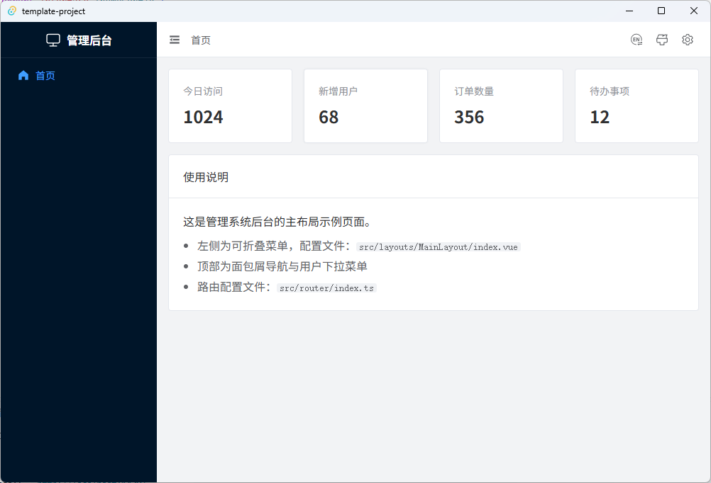

# Template Project

基于 **Tauri 2 + Vue 3 + TypeScript** 的桌面管理后台模板，开箱即用地提供了后台主布局、明暗主题切换、中英双语、SQLite 本地持久化与 Element Plus 集成，适合快速搭建桌面管理应用或离线工具。



## 技术栈

| 类别 | 技术 |
| ---- | ---- |
| 桌面框架 | Tauri 2（Rust） |
| 前端框架 | Vue 3（`<script setup>`）+ TypeScript |
| 构建工具 | Vite |
| UI 组件 | Element Plus + @element-plus/icons-vue |
| 路由 | Vue Router 5（hash 模式） |
| 国际化 | vue-i18n（简体中文 / English） |
| 持久化 | SQLite（rusqlite，`bundled` 静态编译） |
| 样式 | SCSS |

## 功能特性

- 管理后台主布局：可折叠侧边栏 + 顶栏（面包屑导航、语言切换、快捷入口），见 `src/layouts/MainLayout/`
- 三个示例页面：首页、主题设置、系统设置
- 主题系统：明亮 / 暗黑模式 + 主题色切换（自动派生 element-plus 的浅色 / 深色变体），见 `src/composables/useTheme.ts`
- 国际化：简体中文 / English，Element Plus 内置文案同步跟随，见 `src/locales/`
- 本地持久化：SQLite 为唯一真源，localStorage 仅作启动时的同步缓存，见下方「数据持久化」
- Element Plus 全量引入，同时加载明、暗两套 CSS 变量
- 路由使用 hash 模式，避免桌面端打包后刷新 / 深链接出现 404
- Tauri 侧已集成 opener 插件，以及 `kv_get_all` / `kv_set` / `kv_delete` 持久化命令与 `greet` 示例命令（`src-tauri/src/lib.rs`）

## 环境要求

- Node.js 22+（开发验证版本 v22.14.0）与 npm 10+
- Rust 工具链（[rustup](https://rustup.rs) 安装，自带 cargo）
- Tauri 各平台前置依赖见官方文档：https://tauri.app/start/prerequisites/

## 快速开始

```bash
# 1. 安装依赖（只能用 npm install，原因见下方「仓库注意事项」）
npm install

# 2a. 仅启动前端（浏览器调试，http://localhost:1420）
npm run dev

# 2b. 启动完整桌面应用（推荐，会自动拉起前端 dev server）
npm run tauri dev
```

> 开发服务器固定占用 **1420 端口**（`strictPort: true`），端口被占用时会直接失败，而不是自动换端口。

## 常用命令

| 命令 | 说明 |
| ---- | ---- |
| `npm run dev` | 启动前端开发服务器（仅浏览器，不加载 Tauri API） |
| `npm run tauri dev` | 启动桌面应用开发模式（前端 + Rust 热重载） |
| `npm run build` | 类型检查（`vue-tsc --noEmit`）+ 构建前端产物到 `dist/` |
| `npx vue-tsc --noEmit` | 仅执行类型检查 |
| `npm run preview` | 预览 `dist/` 里的前端产物 |
| `npm run tauri build` | 打包桌面应用（内部先执行 `npm run build`），产物位于 `src-tauri/target/release/bundle/` |

> 本项目**没有配置 lint、format、test 工具，也没有 CI**。改动前端后，`npm run build` 就是唯一且必须通过的验证；改 Rust 代码则在 `src-tauri/` 下跑 `cargo check`。

## 项目结构

```
├─ index.html                  # HTML 入口（<title> 即窗口内网页标题）
├─ public/                     # 静态资源（含 README 截图）
├─ src/                        # 前端源码
│  ├─ main.ts                  # 应用入口：先吃缓存同步应用主题/语言，再挂载并与后端对账
│  ├─ App.vue                  # 根组件（el-config-provider 跟随语言）
│  ├─ router/index.ts          # 路由配置（hash 模式，meta.title 存 i18n key）
│  ├─ layouts/MainLayout/      # 后台主布局
│  │  └─ models/               # 历史命名，实际放的是 Vue 组件与菜单配置
│  ├─ views/                   # 页面：dashboard / theme / settings
│  ├─ locales/                 # 国际化：zh-CN.ts（基准）/ en-US.ts / index.ts
│  ├─ composables/useTheme.ts  # 主题单例（明暗模式 + 主题色）
│  ├─ services/storage.ts      # 统一存储层，业务代码不要直接碰 localStorage
│  └─ stores/ components/ utils/   # 预留空目录（未被 git 跟踪）
├─ src-tauri/                  # Rust / Tauri 侧
│  ├─ src/lib.rs               # Tauri 入口：插件、SQLite 初始化、命令注册
│  ├─ src/db.rs                # SQLite 持久化（rusqlite，单张 kv 表）
│  ├─ src/main.rs              # 二进制入口，调用 template_project_lib::run()
│  ├─ capabilities/            # 窗口 / 插件权限配置
│  ├─ gen/schemas/             # 生成产物（已提交，改权限后自动重新生成，勿手改）
│  ├─ icons/                   # 应用图标（打包用）
│  └─ tauri.conf.json          # Tauri 配置（dev/build 脚本、窗口、打包、应用标识）
└─ vite.config.ts              # Vite 配置（为 Tauri 定制：固定端口、忽略 src-tauri）
```

## 数据持久化

**SQLite 是唯一真源，localStorage 只是启动时的同步缓存。** 原因：`invoke()` 是异步的，而主题、语言这类配置必须在首帧渲染前生效，否则会闪一下旧样式。

- 后端：`src-tauri/src/db.rs` 用 rusqlite 打开 `应用数据目录/app.db`（安装目录通常只读，所以不放可执行文件旁边），只建一张 `kv` 表
- 命令：`kv_get_all`（前端启动时一次拉全量，别逐条读）、`kv_set`、`kv_delete`，都返回 `Result<_, String>` 交给前端降级处理
- 前端：统一走 `src/services/storage.ts`，导出 `readStorage` / `readObject` / `writeStorage` / `writeObject` / `removeStorage` / `initStorage` / `synced`
- 只缓存 `app:` 前缀的键，避免和别的来源的数据搅在一起；当前已用的键：`app:theme`、`app:locale`、`app:settings`
- 启动流程：`main.ts` 先用缓存同步调用 `applyTheme()` / `applyLocale()` 并挂载，之后 `initStorage()` 与后端对账，对账结果**以后端为准**，完成后 `reloadTheme()` / `reloadLocale()` 重放
- 组件要读到后端数据时，`watch(synced, ...)` 即可（见 `src/views/settings/index.vue`）
- 浏览器环境（`npm run dev`）没有 Tauri 后端，`invoke()` 必然失败，storage 层会捕获并退化为纯 localStorage

## 国际化

- 文案集中在 `src/locales/`：`zh-CN.ts` 是基准语言，**新增文案先加到这里**；`en-US.ts` 用 `MessageSchema` 类型约束，漏译会直接编译报错
- 组件内取翻译：`const { t } = useI18nGlobal()`（必须 `useScope: "global"`，否则 `t()` 会原样返回 key）
- 路由 `meta.title` 和 `menus.ts` 的 `title` 存的是 i18n key（如 `menu.dashboard`），**不是文案**，展示前必须过 `t()`
- 切换语言：顶栏的语言下拉图标、设置页的「界面语言」，共用 `setLocale`，持久化在 `app:locale`；Element Plus 内置文案由 `App.vue` 的 `<el-config-provider :locale>` 跟随
- 新增第三种语言：在 `SUPPORTED_LOCALES` 加一项，新建语言包文件，并补上 `ELEMENT_PLUS_LOCALES` 对应项

## 常见开发任务

- **新增页面**：在 `src/router/index.ts` 注册路由并填写 `meta.title`（面包屑依赖它）
- **侧边栏菜单**：在 `src/layouts/MainLayout/models/menus.ts` 添加菜单项；主题 / 设置页不占用菜单，由顶栏图标进入
- **调用 Rust 能力**：在 `src-tauri/src/lib.rs` 定义 `#[tauri::command]` 并注册到 `invoke_handler`，前端通过 `@tauri-apps/api` 的 `invoke()` 调用；插件 / 内置权限才需要改 `src-tauri/capabilities/default.json`，自定义命令不用
- **改默认主题 / 主题色**：`src/composables/useTheme.ts` 的 `DEFAULT_CONFIG`
- **改窗口标题与应用标识**：`src-tauri/tauri.conf.json` 的 `app.windows[0].title`、`productName`、`identifier`
- **换应用图标**：替换 `src-tauri/icons/` 下的图片（需覆盖 32×32 / 128×128 / 128×128@2x / icns / ico）
- **改端口**：`vite.config.ts` 的 `server.port` 与 `tauri.conf.json` 的 `devUrl`，两处要一起改

## 项目改名

改名需要同时动 9 个文件（`package.json`、`package-lock.json`、`Cargo.toml`、`Cargo.lock`、`tauri.conf.json`、`main.rs`、`index.html`、`README.md`、`AGENTS.md`），其中 Rust 的 lib 名还必须从 `my-app` 推导成 `my_app_lib`（Windows 下与二进制名冲突）。

直接运行仓库根目录的 `rename-project.bat`，按提示输入新包名、窗口标题和应用标识即可一次性改完；脚本只改文件内容，不重命名根目录文件夹。改完建议跑一下 `npm run tauri dev` 验证，并用 `git grep -i <旧名字>` 确认没有残留。

## 打包发布

```bash
npm run tauri build
```

产物位于 `src-tauri/target/release/bundle/`，按平台分别生成 `.msi` / `.exe`（NSIS）、`.dmg`、`.deb` / `.AppImage` 等。打包前会自动执行 `npm run build`（含类型检查），类型错误会直接中断打包。首次 release 构建编译量较大（rusqlite 的 `bundled` 特性会把 SQLite 静态编译进产物），耗时属正常。

## 仓库注意事项

- `.gitignore` 忽略了 `package-lock.json` 和它自身，**clone 下来没有锁文件，`npm ci` 会失败，只能 `npm install`**
- `dist/`、`src-tauri/target/` 已忽略；`src-tauri/gen/schemas/` 是生成产物但已提交，改权限后会重新生成
- 没有 lint / format / test 配置，也没有 CI，`npm run build` 是提交前的唯一门禁
- 提交前可以用 `git grep -i <关键词>` 全局搜索遗漏的硬编码文案或旧名字

## 常见问题

- **端口 1420 被占用**：`npm run dev` 会直接失败而不是换端口，先结束占用 1420 的进程
- **浏览器里 `invoke()` 报错**：预期行为，`npm run dev` 没有 Tauri 后端，storage 层会退化为纯 localStorage，别据此判断功能坏了
- **`el-container` 排列方向不对**：包裹 `el-container` 必须显式传 `direction`，它靠子组件名判断方向，用自定义组件包一层后会失效

## 推荐 IDE

VS Code + [Vue - Official](https://marketplace.visualstudio.com/items?itemName=Vue.volar) + [Tauri](https://marketplace.visualstudio.com/items?itemName=tauri-apps.tauri-vscode) + [rust-analyzer](https://marketplace.visualstudio.com/items?itemName=rust-lang.rust-analyzer)

## License

[Apache-2.0](./LICENSE)
